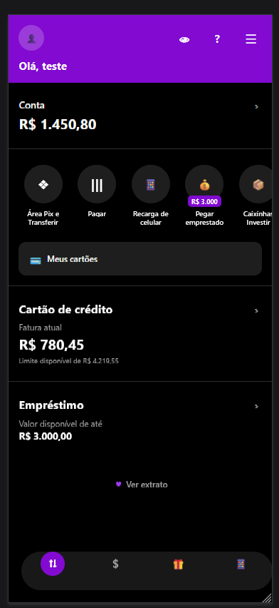
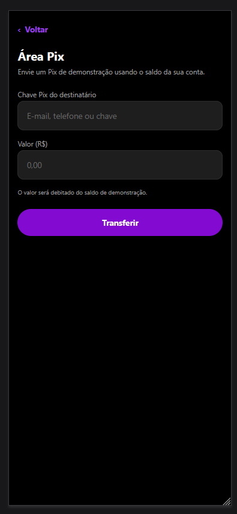
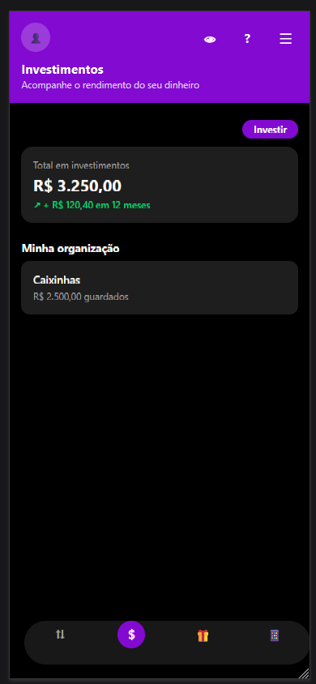
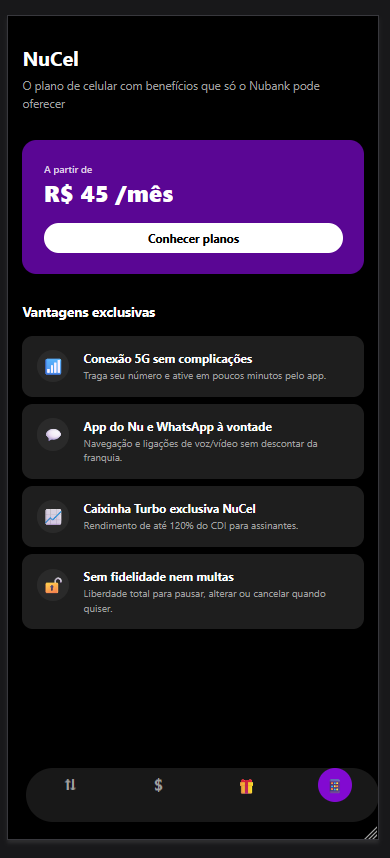

# Banking App (Nubank Clone) — Avaliação P2

Aplicação bancária híbrida desenvolvida com **React Native** e **Expo SDK 57**, integrada a uma API **Node.js (Express / TypeScript)** e banco de dados **PostgreSQL 17** via **Prisma ORM**.

---

### Demonstração Visual

<div align="center">
  
  
  
  
</div>

<p align="center">
  <em>Tela Principal • Área Pix • Investimentos • NuCel</em>
</p>

---

## Como Executar

### 1. Com Docker Compose (Recomendado)

Inicie o banco PostgreSQL, a API e o aplicativo com um único comando:

```bash
docker compose up --build
```

* **App (Web):** [http://localhost:8081](http://localhost:8081)
* **API:** [http://localhost:3001](http://localhost:3001)

### 2. Execução Local

Caso prefira rodar os serviços separadamente na sua máquina:

```bash
# 1. Inicie a API e sincronize o banco de dados
cd api
npm install
npx prisma db push
npm run dev

# 2. Em outro terminal, inicie o app
npm install
npx expo start --web
```

---

## Recursos e Arquitetura

* **Autenticação e Armazenamento Seguro:** Cadastro e login com senhas criptografadas em `bcryptjs` e emissão de JWT. No mobile, o token de sessão é armazenado de forma criptografada pelo `expo-secure-store` (utilizando o Android Keystore e o iOS Keychain), garantindo persistência sem expor dados sensíveis. Na Web, a sessão é gerenciada via cookies `HttpOnly` com validação de origem.
* **Transações Concorrentes:** Operações de Pix e pagamento de boletos com validação de saldo e débitos atômicos no PostgreSQL, prevenindo condições de corrida.
* **Extrato e Modo de Privacidade:** Histórico de transações sincronizado em tempo real com o banco e alternância global de visibilidade de saldo (`R$ •••••`) em todas as telas.
* **Navegação Híbrida:** Rotas organizadas por abas e modais, com proteção dinâmica de telas via `Stack.Protected` do Expo Router v57 e fallback para rotas inexistentes (`+not-found.tsx`).
